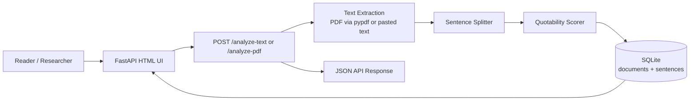

# Paper Trail

Paper Trail is a small FastAPI MVP that accepts pasted text or an uploaded PDF and returns a ranked list of the most quotable sentences with confidence scores.

The ranking engine is local and deterministic: it scores sentences using quote-friendly heuristics such as clarity, length, strong verbs, contrast words, punctuation, and low boilerplate density. No external AI API is required.

## Architecture



## Features

- Paste text and analyze it instantly.
- Upload a PDF and extract text locally.
- Rank sentences by quotability score.
- Store analyzed documents and sentences in SQLite.
- View recent analyses and individual document results.
- Includes a smoke test for the main text-analysis flow.

## Requirements

- Python 3.11+

## Run locally

```bash
cd brain-paper-trail
python -m venv .venv
source .venv/bin/activate  # Windows: .venv\\Scripts\\activate
pip install -r requirements.txt
uvicorn app.main:app --reload
```

Open http://127.0.0.1:8000 in your browser.

## One-command Docker option

If you prefer Docker:

```bash
cd brain-paper-trail
docker compose up --build
```

Open http://127.0.0.1:8000.

## Environment variables

Copy `.env.example` to `.env` if you want to customize settings.

| Variable | Default | Description |
| --- | --- | --- |
| `DATABASE_URL` | `sqlite:///./paper_trail.db` | SQLAlchemy/SQLModel database URL. SQLite is recommended for the MVP. |
| `APP_NAME` | `Paper Trail` | App name displayed in generated pages. |
| `MAX_TEXT_CHARS` | `120000` | Maximum number of extracted/pasted characters accepted per analysis. |
| `TOP_N_SENTENCES` | `10` | Number of ranked sentences returned by default. |

## API usage

Analyze pasted text:

```bash
curl -X POST http://127.0.0.1:8000/analyze-text \
  -H "Content-Type: application/json" \
  -d '{"title":"Demo","text":"Reading changes how we notice the world. Strong sentences carry pressure and precision. This is a short note."}'
```

Analyze a PDF:

```bash
curl -X POST http://127.0.0.1:8000/analyze-pdf \
  -F "title=My PDF" \
  -F "file=@paper.pdf"
```

## Run smoke test

```bash
pytest
```
